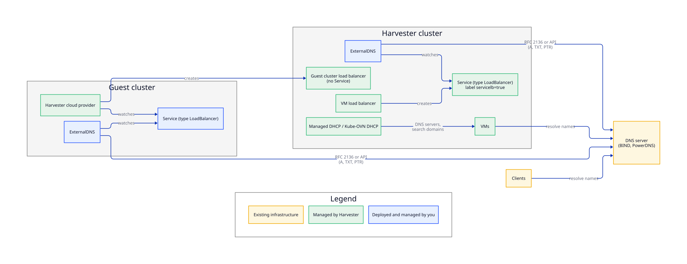

You can integrate Harvester with the DNS servers that already exist in your environment. Specifically, you can configure the DNS settings that virtual machines (VMs) receive, and you can use [ExternalDNS](https://kubernetes-sigs.github.io/external-dns/) to publish DNS records for Harvester load balancers (LBs) and for `LoadBalancer` services in guest clusters.

This procedure was tested with **Harvester v1.9.0**, **ExternalDNS v0.15.0**, **BIND 9.20**, and **PowerDNS Authoritative Server 4.9**. The guest cluster load balancer example was tested with an RKE2 v1.36.5 guest cluster that uses the Harvester cloud provider v0.2.8.

## User Stories

- An infrastructure team runs application VMs behind Harvester load balancers. Application owners want to reach each application by a name in the corporate DNS zone (for example, `web.vm.example.com`) instead of an IP address. The DNS record must be created when the load balancer is created and removed when the load balancer is deleted, without a manual request to the DNS team. The VMs must also resolve internal names by using the corporate DNS servers.

- A platform team runs RKE2 guest clusters on Harvester. Developers expose applications with `LoadBalancer` services and want each service to be resolvable by name in the corporate DNS zone as soon as it receives an IP address.

## Architecture

The following diagram shows the components involved and which party manages each component.



Harvester and your existing infrastructure have the following responsibilities:

| Component | Managed by | Responsibility |
| --- | --- | --- |
| VM load balancers and their `LoadBalancer` services | Harvester | Assigns an IP address from an IP pool or from DHCP, and records it in the service status |
| Managed DHCP add-on and Kube-OVN DHCP | Harvester (configured by you) | Sends the DNS servers and search domains that you configure to VMs |
| Harvester cloud provider in guest clusters | Harvester | Creates a Harvester load balancer for each `LoadBalancer` service in the guest cluster |
| ExternalDNS | You | Watches services and creates and deletes the DNS records that it owns. You deploy, configure, and upgrade it. |
| DNS server, zones, and TSIG keys | You | Serves the zones, accepts dynamic updates from ExternalDNS, and answers queries from VMs and clients |

ExternalDNS is a third-party component that is not installed or managed by Harvester. ExternalDNS is available in the [SUSE Application Collection](https://apps.rancher.io/applications/external-dns). You can run ExternalDNS in the Harvester cluster or outside it, provided that it can read services from the Harvester Kubernetes API. When ExternalDNS runs outside the cluster, a service account with read-only access to services is sufficient.

## DNS Integration Options

The following table outlines the available options:

| Use case | Mechanism | Reference |
| --- | --- | --- |
| Assign DNS servers and search domains to VMs on VM networks | Managed DHCP (`dns`, `domainName`, and `domainSearch` fields of the `IPPool` resource) | [Managed DHCP](https://docs.harvesterhci.io/v1.9/advanced/addons/managed-dhcp) |
| Assign DNS servers to VMs on Kube-OVN subnets | Kube-OVN DHCP (`dhcpV4Options` field of the subnet) | [Virtual Private Cloud (VPC)](https://docs.harvesterhci.io/v1.9/networking/kubeovn-vpc) |
| Assign DNS servers to VMs with static network configuration | Cloud-init network data | [Cloud-init](https://docs.harvesterhci.io/v1.9/vm/index#cloud-init) |
| Publish DNS records for VM load balancers | ExternalDNS | [Publish DNS Records for VM Load Balancers](#publish-dns-records-for-vm-load-balancers) |
| Publish DNS records for guest cluster load balancers | ExternalDNS (deployed in the guest cluster) | [Publish DNS Records for Guest Cluster Load Balancers](#publish-dns-records-for-guest-cluster-load-balancers) |

## Configure DNS Settings for VMs

VMs obtain DNS settings from the network configuration that they receive. You can use any of the following methods:

- **Managed DHCP**: Specify the `dns`, `domainName`, and `domainSearch` fields in the `IPPool` resource. The Managed DHCP agent sends these values to VMs as DHCP options. For more information, see [Managed DHCP](https://docs.harvesterhci.io/v1.9/advanced/addons/managed-dhcp).

- **Kube-OVN DHCP**: Specify the DNS server in the `dhcpV4Options` field of the subnet (for example, `dns_server=10.0.0.53`). For more information, see [Virtual Private Cloud (VPC)](https://docs.harvesterhci.io/v1.9/networking/kubeovn-vpc).

- **External DHCP server or static configuration**: Configure the DNS settings on your DHCP server, or specify the DNS servers in the cloud-init network data when you create the VM.

### Limitations

- Harvester does not automatically create DNS records for the IP addresses of individual VMs. You can use ExternalDNS to publish DNS records only for load balancers.

- The Managed DHCP add-on does not send the hostname option (option 12) and does not process the client FQDN option (option 81). Consequently, DHCP-based dynamic DNS updates are not supported for VMs that obtain IP addresses from Managed DHCP.

## Publish DNS Records for VM Load Balancers

Each VM load balancer is backed by a Kubernetes `Service` of type `LoadBalancer`. The service has the following characteristics:

- It has the same name and namespace as the load balancer.
- It has the label `loadbalancer.harvesterhci.io/servicelb: "true"`.
- Its `status.loadBalancer.ingress` field contains the IP address assigned to the load balancer.

This applies to load balancers that use either the IP pool or the DHCP IPAM mode.

Because the service is a standard Kubernetes resource, ExternalDNS can watch it and automatically create or update the corresponding DNS records on your DNS server.

### Prerequisites

Before you begin, ensure that the following requirements are met:

- The DNS server supports dynamic updates (RFC 2136) and is reachable from the location where ExternalDNS runs.

- A TSIG key is configured on the DNS server, and the key is allowed to update the target zone. For a BIND configuration example, see the [ExternalDNS RFC 2136 tutorial](https://kubernetes-sigs.github.io/external-dns/latest/docs/tutorials/rfc2136/).

The examples in this section use the following settings:

- **DNS server**: `192.168.100.53` (BIND)
- **Zone**: `vm.example.com`
- **TSIG key name**: `externaldns-key`
- **TSIG algorithm**: `hmac-sha256`

### Deploy ExternalDNS

1. Create the namespace for ExternalDNS.

    ```shell
    kubectl create namespace external-dns
    ```

1. Create a secret that contains the TSIG secret.

    ```shell
    kubectl create secret generic external-dns-tsig \
      --namespace external-dns \
      --from-literal=tsig-secret='<base64-tsig-secret>'
    ```

1. Deploy ExternalDNS with the RBAC resources described in the [ExternalDNS RFC 2136 tutorial](https://kubernetes-sigs.github.io/external-dns/latest/docs/tutorials/rfc2136/), and configure the container as follows:

    ```yaml
    containers:
    - name: external-dns
      image: registry.k8s.io/external-dns/external-dns:v0.15.0
      args:
      - --source=service
      # Watch only the services created by the Harvester load balancer
      - --label-filter=loadbalancer.harvesterhci.io/servicelb=true
      # Generate a DNS name for each load balancer
      - --fqdn-template={{ .Name }}.{{ .Namespace }}.vm.example.com
      - --domain-filter=vm.example.com
      - --provider=rfc2136
      - --rfc2136-host=192.168.100.53
      - --rfc2136-port=53
      - --rfc2136-zone=vm.example.com
      - --rfc2136-tsig-keyname=externaldns-key
      - --rfc2136-tsig-secret-alg=hmac-sha256
      - --rfc2136-tsig-axfr
      - --registry=txt
      - --txt-owner-id=harvester-cluster-1
      - --policy=upsert-only
      env:
      - name: EXTERNAL_DNS_RFC2136_TSIG_SECRET
        valueFrom:
          secretKeyRef:
            name: external-dns-tsig
            key: tsig-secret
    ```

    With this configuration, ExternalDNS publishes a DNS record named `<load-balancer-name>.<namespace>.vm.example.com` for each VM load balancer.

1. [Create a VM load balancer](https://docs.harvesterhci.io/v1.9/networking/loadbalancer#how-to-create).

1. Verify that the DNS record resolves to the IP address of the load balancer.

    ```shell
    dig +short <load-balancer-name>.<namespace>.vm.example.com @192.168.100.53
    ```

:::note

- ExternalDNS uses TXT records to track the DNS records that it manages. If multiple clusters write to the same zone, specify a unique `--txt-owner-id` value for each cluster.
- To manage reverse (PTR) records, add the `--rfc2136-create-ptr` flag, add the reverse zone to both the `--rfc2136-zone` and `--domain-filter` flags (for example, `--rfc2136-zone=100.168.192.in-addr.arpa` and `--domain-filter=100.168.192.in-addr.arpa`), and ensure that the TSIG key is allowed to update the reverse zone.

:::

### Assign a Custom Hostname

To use a specific hostname instead of the name generated by `--fqdn-template`, add the `external-dns.alpha.kubernetes.io/hostname` annotation to the load balancer's service.

Example:

```shell
kubectl annotate service <load-balancer-name> --namespace <namespace> \
  external-dns.alpha.kubernetes.io/hostname=web.vm.example.com
```

### DNS Record Lifecycle

ExternalDNS manages the DNS records of each load balancer according to the value of the `--policy` flag:

| Event | `--policy=upsert-only` | `--policy=sync` |
| --- | --- | --- |
| A load balancer is created and receives an IP address | ExternalDNS creates the A record and its TXT ownership record. If PTR management is enabled, it also creates the PTR record. | Same as `upsert-only` |
| The `external-dns.alpha.kubernetes.io/hostname` annotation is added to the service | ExternalDNS creates a record for the annotated hostname. The record with the name generated by `--fqdn-template` remains in the zone. | ExternalDNS creates a record for the annotated hostname and deletes the record with the name generated by `--fqdn-template`. |
| A load balancer is deleted | The records remain in the zone. | ExternalDNS deletes the A, TXT, and PTR records. |

In both modes, ExternalDNS only modifies the records that it owns, and does not change records that were created by other means.

## Publish DNS Records for Guest Cluster Load Balancers

`LoadBalancer` services in guest clusters that use the [Harvester cloud provider](https://docs.harvesterhci.io/v1.9/rancher/cloud-provider) are standard Kubernetes services. To publish DNS records for these services, deploy ExternalDNS in the guest cluster and configure it for your DNS server. You can then add the `external-dns.alpha.kubernetes.io/hostname` annotation to each service.

The IP address of a guest cluster load balancer appears in the service's `status.loadBalancer.ingress` field only after the service has at least one ready endpoint. Until then, ExternalDNS does not publish a DNS record for the service.

For more information, see the [ExternalDNS documentation](https://kubernetes-sigs.github.io/external-dns/).

## DNS Server Integrations Included in ExternalDNS

ExternalDNS includes integrations (providers) for a wide range of DNS servers. These integrations are developed and maintained by the ExternalDNS project. The following table lists providers that are commonly used in on-premises environments:

| DNS server | ExternalDNS provider | Authentication method |
| --- | --- | --- |
| BIND and other servers that support RFC 2136 | `rfc2136` | TSIG key |
| PowerDNS | `pdns` | API key |

For a complete list of providers, including public cloud DNS services, see the [ExternalDNS documentation](https://kubernetes-sigs.github.io/external-dns/).
